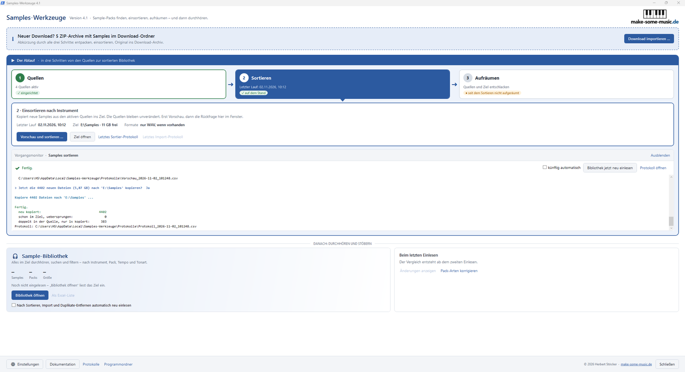
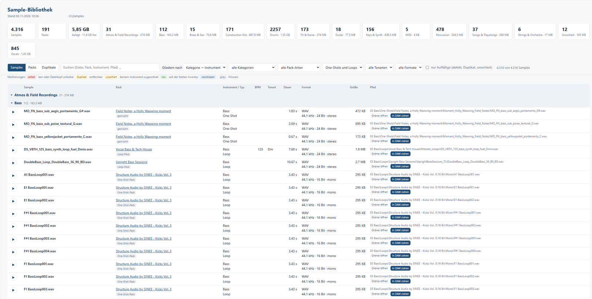
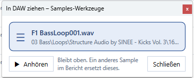

# Samples-Werkzeuge

Sortiert Audio-Sample-Packs unter Windows nach Instrument in eine aufgeräumte Sample-Bibliothek –
und macht sie zum Durchhören, Suchen und Ziehen in die DAW bereit.
Kostenlos, ohne Installation (Windows PowerShell 5.1, bei Windows 10 und 11 dabei).

**Download:** [neueste Version](https://github.com/limerick71/sampleswerkzeuge/releases/latest) – ZIP-Datei herunterladen und entpacken.

## Was es kann

- **Fundorte suchen:** findet Ordner und ZIP-Dateien mit Samples auf dem Rechner (Downloads, weitere Laufwerke …) und übernimmt sie als Quellen.
- **Sortieren:** kopiert alle Samples nach Instrument und One-Shot/Loop in die Bibliothek (`01 Drums\Kick\One-Shots\<Pack>\…`, `07 Vocals\<Pack>\…`, `10 Construction Kits\…`). Mit Vorschau vor jedem Kopieren; die Quellen werden dabei nie verändert, nichts wird überschrieben, Doppeltes nur einmal kopiert (Prüfsumme).
- **Download importieren:** frisch heruntergeladene Packs (ZIP oder Ordner) in einem Schritt entpacken, einsortieren und das Original archivieren – erst nachdem jede Datei per Prüfsumme im Ziel bestätigt ist.
- **Aufräumen:** Duplikate, macOS-Reste und überzählige Formate (RX2/MP3/AIFF neben gleichnamiger WAV) in Quellen und Bibliothek entfernen – nur auf Rückfrage und immer in den Papierkorb.
- **Sample-Bibliothek:** liest die Bibliothek ein (Pack-Art, Dauer, BPM, Tonart, Duplikate, Änderungen) und zeigt sie als Bericht im Browser: suchen, filtern, anhören, Ordner öffnen und **In DAW ziehen**.

Aus dem Bericht wandert ein Sample über das kleine Fenster „In DAW ziehen“ per Maus in die DAW:

## Erste Schritte

1. ZIP-Datei mit Rechtsklick > „Alle extrahieren …“ an einen festen Ort entpacken (z. B. Dokumente).
2. `GUI_Samples-Werkzeuge.cmd` doppelklicken. Beim ersten Start fragt die Begrüßung nach dem Ziel für die Bibliothek (bitte nicht in OneDrive) und legt auf Wunsch eine Desktop-Verknüpfung an.
3. Im Hauptfenster dem Ablauf folgen: **1 Quellen** („Fundorte suchen …“) ➜ **2 Sortieren** ➜ **3 Aufräumen**, danach „Bibliothek öffnen“.

Ausführlich: `Erste Schritte.txt` und `Dokumentation Samples-Werkzeuge.rtf` im Programmordner.

### Windows-Warnung beim ersten Start

Windows kennzeichnet heruntergeladene Dateien. Erscheint „Der Computer wurde durch Windows geschützt“:
„Weitere Informationen“ > „Trotzdem ausführen“. Alternativ vor dem Entpacken: Rechtsklick auf die ZIP-Datei >
Eigenschaften > Haken „Zulassen“ > OK. Das Programm besteht aus lesbaren PowerShell-Skripten (Ordner `Skripte`).

## Fehler melden, Wünsche

Bitte als [Issue auf GitHub](https://github.com/limerick71/sampleswerkzeuge/issues) mit:
Version (steht im Fenstertitel), was du getan hast, was passiert ist und was du erwartet hast.
Hilfreich sind der Verlauf des Vorgangs (`Vorgang_<Datum>_<Vorgang>.txt`) und, falls vorhanden, `Fehler.log` –
beide im Datenordner `%LOCALAPPDATA%\Samples-Werkzeuge` (Ordner `Protokolle` bzw. direkt darin; Knopf „Protokolle“ im Hauptfenster).
Die Dateien enthalten Ordner- und Dateinamen deines Rechners – vor dem Hochladen bei Bedarf kürzen.

## Wo was liegt

| Ort | Inhalt |
|---|---|
| Programmordner | `GUI_Samples-Werkzeuge.cmd` (Oberfläche), `Samples sortieren.cmd`, `Bibliothek einlesen.cmd`, `Quelle aufraeumen.cmd` (ohne Oberfläche), Anleitungen, `Skripte/` – darf jederzeit gelöscht bzw. durch eine neue Version ersetzt werden |
| `%LOCALAPPDATA%\Samples-Werkzeuge` | `Einstellungen.json`, `Pack-Arten.csv` (eigene Korrekturen), `Protokolle/` (Vorschauen, Protokolle, Verläufe), `Fundorte/` (Berichte des Suchlaufs) |
| Ziel `\99_Protokolle` | Protokolle von Sortieren, Import, Aufräumen; `Bibliothek/` mit den letzten 10 Ständen der Sample-Bibliothek (Liste, Bericht, Vergleich) |

Eine neue Version einfach neben der alten entpacken: Ab 4.1 benutzen alle Versionen denselben Datenordner;
aus einer Version bis 4.0.2 übernimmt sie beim ersten Start einmalig Einstellungen, Korrekturen und Protokolle.

### Für Entwickler

`Skripte/`: `Gemeinsam.ps1` (Pfade, Einstellungen, Regeln), `Samples-Werkzeuge.ps1` (Hauptfenster, WPF), `Dialoge.ps1` (übrige Fenster, WinForms), `Samples-sortieren.ps1`, `Inventur.ps1` (Bibliothek einlesen), `Bericht.ps1` (HTML-Bericht), `Bericht-Dienst.ps1` (lokaler Dienst auf 127.0.0.1 für Abspielen, Entfernen, Ordner öffnen und In DAW ziehen), `DAW-Ziehen.ps1` (Fenster „In DAW ziehen“), `Fundorte-suchen.ps1`, `Fundorte-Bericht.ps1`, `Ziel-Duplikate-entfernen.ps1`, `Quelle-aufraeumen.ps1`, `Download-importieren.ps1`, `Import.ps1` (ZIP sicher lesen und entpacken). `tools/dokumentation.py` erzeugt die RTF-Dokumentation.

## Versionen

| Version | Datum | Inhalt |
|---|---|---|
| 4.1.2 | 02.11.2026 | Befunde aus dem Test der 4.1.1: Logo größer; Hersteller-Bibliotheken in allen Texten allgemein beschrieben; Bildschirmfotos in der Dokumentation |
| 4.1.1 | 02.11.2026 | Befunde aus dem Test der 4.1: Fenster füllt im Vollbild genau den Bildschirm, Vorgangsmonitor so groß wie möglich; neues Logo; Frageleiste „Bibliothek jetzt neu einlesen?“ mit „Einlesen künftig automatisch“; schreibgeschützte Einstellungen werden wieder beschreibbar gemacht |
| 4.1 | 02.11.2026 | Programm und Daten getrennt (`%LOCALAPPDATA%\Samples-Werkzeuge`, Bibliotheks-Stände im Ziel, einmalige Übernahme); erster Start ohne voreingestellte Ordner (Ziel-Vorschlag, OneDrive-Warnung); Ziel nicht gefunden = rot; „Bibliothek jetzt neu einlesen“, auf Wunsch automatisch; „In DAW ziehen“; allgemeine Regeln für Construction Kits, Songs und Sammelordner statt Regeln für einzelne Packs; Hersteller-Bibliotheken ausgespart; Logo, Verlauf füllt das Fenster, farbige Zeilen fett |
| 4.0.2 | 01.11.2026 | Befunde aus dem Test der 4.0.1: Verlauf im Vorgangsmonitor scrollbar und mit dem Fenster wachsend, nur noch „Ausblenden“/„Einblenden“, „Abgebrochen“ nach „Nein“, Überschriften blau; Instrument im Dateinamen vor Pack-Name „Vocal“; make-some-music.de im Urheberhinweis; Import-Kasten größer geschrieben |
| 4.0.1 | 01.11.2026 | Befunde aus dem Test der 4.0: Vorgangsmonitor (Schließen/Einblenden, gehört zu seinem Schritt, Ausgabe als Textdatei); keine falsche Fehlermeldung durch Fortschrittsdaten; Stand von Ablauf und Bibliothek aus dem Ziel (99_Protokolle); Import-Kasten zählt nur ZIPs mit Samples; „Nur lose Dateien“ nur neue Audiodateien; Ordner öffnen mit dem richtigen Ordner; „Abbrechen“ rechts |
| 4.0 | 31.10.2026 | Neues Hauptfenster (WPF): geführter Ablauf Quellen ➜ Sortieren ➜ Aufräumen mit Stand je Schritt, Download importieren als Abkürzung, „Sample-Bibliothek“ statt Inventur (fragt beim Öffnen nach dem Einlesen); Fortschritt, Ausgabe und Rückfragen im Fenster statt eigener Konsolen; Import zeigt Plugin-Ordner ohne Audio nicht mehr |
| 3.0.1 | 31.10.2026 | Befunde aus dem Test der 3.0: Import erkennt Instrument-Bibliotheken und Bundles (Pack-Art änderbar), übergeht Downloads ohne Audio; erste Ordnerebene unter dem Pack bleibt erhalten; Protokolle im Ziel unter 99_Protokolle |
| 3.0 | 30.10.2026 | Download importieren: frisch heruntergeladene Packs (ZIP oder Ordner) in einem Schritt entpacken, einsortieren und das Original ins Download-Archiv verschieben, liegen lassen oder in den Papierkorb legen – mit Vorschau, Prüfsummen und Import-Protokoll; Instrument-Kürzel zuverlässiger; Archive im Fundort-Bericht als eigene Zeile |
| 2.3.5 | 30.10.2026 | Befunde aus dem Test der 2.3.4: One-Shots mit Laufnummer; einheitlich „Sortieren“; Fundort-Bericht mit Quelle und „(deaktiviert)“, Haken für alle; ZIP mit ungewöhnlichen Namen; Fundorte-Fenster merkt die Auswahl; „Quelle aufräumen“ fragt zuerst die Quellen; „Packs liegen tiefer“ deutlich sichtbar; Cubase/Ableton-Projekte wieder als DAW-Projekt |
| 2.3.4 | 29.10.2026 | Befunde aus dem Test der 2.3.3: Archive robuster gelesen (Grund bei nicht prüfbaren); Innenordner eines Packs erkannt; DAW-Projekt nur mit Projektdatei; Inventur mit Keys/Synth/Melodic; „nur Auffällige“ in der Pack-Ansicht; Packs liegen tiefer – Hinweis und Umstellen; Vocals ohne inneren Ordnerweg; kleine Fundorte standardmäßig sichtbar |
| 2.3.3 | 28.10.2026 | Befunde aus dem Test der 2.3.2: keine Installer, Plugin-Inhalte und Archive kopieren; Sammelordner nur als „Nur lose Dateien“; Pack-Ebene (z. B. Splice); lange Pfade; neue Instrumente und Kategorie 13 Strings & Orchestra; RX2 als Loop neben der WAV; Formate im Ziel entfernen |
| 2.3.2 | 28.10.2026 | Befunde aus dem Test der 2.3.1: Entfernen in den Einstellungen, Art in der Liste mit Erklärung ⓘ, Vocals über Ordnernamen, „Einzeldateien (…)“ bei losen Dateien; Fundort-Bericht mit ZIP-Inhalt, Ableton-Erkennung, „Letzten Bericht öffnen“, Abgleich mit dem Ziel-Ordner auch für Quellen |
| 2.3.1 | 28.10.2026 | Art einer Quelle (Sammlung, Ein Pack, Nur lose Dateien); richtiger Pack-Name bei einzelnen Packs; lose Dateien in Downloads übernehmbar |
| 2.3.0 | 28.10.2026 | Fundorte suchen (Suchlauf, Bericht, Übernahme als Quellen); Quellenliste statt einer Quelle; Sortieren und Aufräumen über mehrere Quellen; Befunde aus dem Test der 2.2 |
| 2.2.0 | 27.10.2026 | „Ordner öffnen“ im Bericht; Formate in „Quelle aufräumen“ eigens wählbar; Gruppe „Originale“ (Kopie im Ziel per Prüfsumme bestätigt); Warnung, wenn die Menge nicht in den Papierkorb passt |
| 2.1.0 | 27.10.2026 | Sortieren verändert die Quelle nie; „Quelle aufräumen“ (Duplikate, macOS-Reste, Formate) ersetzt „Duplikate entfernen“; Häkchen RX2/MP3/AIFF neben gleichnamiger WAV; macOS-Reste per Dateikopf; MP3-Eigenschaften; Löschen von Duplikaten aus dem Bericht; Packs-Ansicht nach Packname; Einstellungen im eigenen Fenster (⚙), Status mit Pfaden |
| 2.0.0 | 26.10.2026 | Inventur der Bibliothek (Pack-Art, Audio-Eigenschaften, BPM, Tonart, Duplikate, Vergleich), HTML-Bericht im Stil der Plugin-Werkzeuge (Samples/Packs/Duplikate, Gliederung, Filter, Abspielen), Duplikate im Ziel entfernen, macOS-Reste beim Sortieren in den Papierkorb, Häkchen „RX2 beibehalten“ |
| 1.2.1 | 26.10.2026 | W-07b: Quelle ohne Audiodateien zeigt nur einen Hinweis; Hilfsdateien mit Grund in Vorschau und Dokumentation; ModX-Hinweis nur bei vorhandenem Ordner |
| 1.2.0 | 26.10.2026 | Abgleich neuer Dateien mit dem ganzen Ziel nach Inhalt (Vorfilter Größe, dann Prüfsumme): gleicher Inhalt in anderem Ordner oder unter anderem Namen wird nicht erneut kopiert; Kits ausgenommen; Spalte „Hinweis“ in Vorschau und Protokoll |
| 1.1.0 | 26.10.2026 | Befunde aus dem Windows-Test: ZIP ohne doppelten Ordner, fehlendes Ziel-Laufwerk wird gemeldet, verständliche Zusammenfassung, Vorschau und Protokoll, bereits vorhandene Dateien schon in der Vorschau erkannt, Junctions übersprungen, Quelle ohne Audiodateien wird abgewiesen |
| 1.0.0 | 26.10.2026 | Ordnerstruktur wie Plugin-Werkzeuge, einstellbare Ordner (Quelle, Ziel, Downloads, Download-Archiv, Berichte), neue Oberfläche mit Status, Begrüßung und Desktop-Verknüpfung, Vorschau mit Rückfrage, Protokolle in eigenem Ordner, Einstellungen werden von der Vorversion übernommen |
| 0 | 21.10.2026 | Ausgangsstand: Sortieren, Duplikate entfernen, einfache Oberfläche, feste Pfade |

## Nutzungsbedingungen

© 2026 Herbert Stöcker · [make-some-music.de](https://make-some-music.de). Kostenlos nutzbar. Bitte nur als Link auf die offizielle Download-Seite
weitergeben; Verkauf und Veröffentlichung geänderter Fassungen nur mit Zustimmung. Die Nutzung erfolgt auf eigene Verantwortung.
Vollständiger Text: [LIZENZ.txt](LIZENZ.txt).
